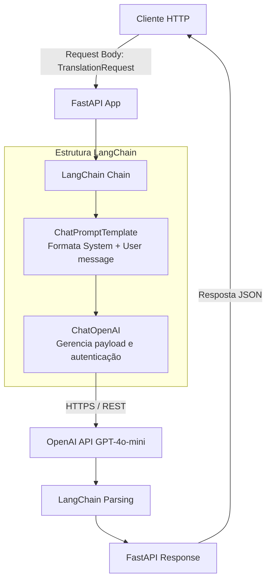
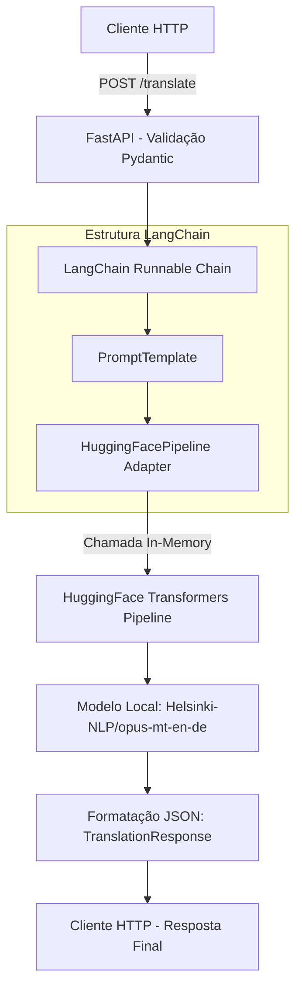

# Parte 1 FastAPI
## Questão 3: Limitações do Modelo opus-mt-en-fr
#### 1. Precisão da Tradução:

    - Tamanho de Contexto Restrito: O modelo possui limite de tokens de entrada (normalmente 512 tokens). Textos longos são truncados ou perdem coesão entre parágrafos.

    - Ambiguidade: Dificuldade para resolver ambiguidades gramaticais sem contexto amplo prévio.

#### 2. Tempo de Resposta e Desempenho:

    - Custo Computacional em CPU: Rodar inferência localmente sem aceleração por GPU (CUDA) gera alta latência por requisição sob concorrência.

    - Bloqueio de Threads: Sem worker pools apropriados (como Celery/Ray), a inferência em CPU pode travar o Event Loop assíncrono do FastAPI.

#### 3. Custo e Escalabilidade:

    - Memória RAM/VRAM: Requer carregamento contínuo do modelo na memória. Escalar horizontalmente consome grande quantidade de hardware.

#### 4. Gírias, Expressões Idiomáticas e Contexto:

    - Tradução Literal: Traduz expressões idiomáticas ao pé da letra (ex: "kick the bucket" vira "couper o bucket" em vez de "mourir").

    - Falta de Atualização: Desconhece neologismos, gírias recentes da internet e termos técnicos específicos de nicho.

## Questão 4: Limitações do GPT-2 na Geração de Texto
- Coerência: O GPT-2 perde a linha de raciocínio em textos médios e longos, gerando repetições em loop ou desvios de assunto.

- Alucinações e Incoerências: Gera fatos falsos apresentados como verdadeiros por não possuir mecanismo de checagem ou acesso a dados em tempo real.

- Latência e Recursos: Por ser executado localmente, a latência de geração token a token aumenta consideravelmente em CPUs convencionais.

- Conteúdo Inapropriado e Viés: Por não ter passado por alinhamento por reforço (RLHF), pode gerar respostas tóxicas, tendenciosas ou com linguagem ofensiva a partir de prompts neutros.

# Parte 2 - LangChain

## Diagrama 1: Questão 1

```mermaid
graph TD
    A[Cliente HTTP] -->|POST /chat {"message": "..."}| B[FastAPI App]
    B --> C(Validação Pydantic)
    B --> D[LangChain Abstraction]
    D --> E[FakeListLLM]
    E -->|Retorna resposta estática da fila| F[Resposta JSON]
    F --> A
```

## Diagrama 2: Questão 2 



## Diagrama 3: Questão 3


## Questão 4 - LangChain: Limitações do uso do LangChain com a API da OpenAI
 - Latência de Resposta: Adiciona sobrecarga (overhead) de abstração de classes e chamadas de rede externas (HTTP/TLS) até a API da OpenAI.

- Limites de Uso (Rate Limits): Dependência das cotas da conta OpenAI (TPM - Tokens Per Minute / RPM - Requests Per Minute). Sob alto tráfego, requisições falharão com erros 429 sem um tratamento explícito de retry/backoff.

- Desafios de Escalabilidade e Custo: Cobrança por token. Operações em larga escala tornam-se caras em comparação com hospedagem de modelos próprios.

- Qualidade da Tradução: Apresenta excelente entendimento de contexto e expressões idiomáticas, superando modelos estáticos de tradução direta.

## Questão 5: Limitações do uso do LangChain com HuggingFace
- Desempenho e Recursos: Alto consumo de RAM e VRAM local. Sem GPU dedicada, a latência de inferência trava chamadas síncronas.

- Overhead de Abstração: O wrapper HuggingFacePipeline do LangChain adiciona conversões extras de texto/prompts que podem ser dispensáveis se comparado ao uso direto da função translator() do HuggingFace.

- Ajuste Fino (Fine-Tuning): O LangChain não foi projetado para treinar ou fazer fine-tuning de modelos; ele apenas orquestra chamadas de inferência.

- Comparação com API Direta: O uso direto dos pipelines da biblioteca transformers é mais simples, consome menos memória de dependências e possui menor latência de código.

## Questão 6: Tabela Comparativa (FastAPI Puro vs. LangChain)

| Critério | FastAPI Puro (Uso Direto de Modelos/Pipelines) | FastAPI + LangChain |
| :--- | :--- | :--- |
| **Facilidade de Uso / Configuração** | **Alta:** Menos abstrações, código direto e legível. | **Média/Baixa:** Requer aprendizado da sintaxe e estruturas do LangChain (LCEL, Prompts, Memory). |
| **Latência e Desempenho** | **Excelente:** Sem camadas adicionais de processamento de código. | **Ligeiramente Menor:** Adiciona pequena sobrecarga de abstração e parsing de objetos. |
| **Flexibilidade de Modelos** | **Limitada:** Trocar de provedor exige reescrever a lógica de integração. | **Altíssima:** Permite alternar entre OpenAI, HuggingFace, Anthropic trocando poucas linhas. |
| **Custo e Escalabilidade** | Custo dependente da infraestrutura (CPU/GPU) ou da API consumida diretamente. | Custo dependente do provedor final + gestão de complexidade de dependências. |
| **Adequação (Protótipos vs. Produção)** | **Ideal para:** APIs focadas, microserviços específicos e alta performance. | **Ideal para:** Protótipos rápidos, aplicações RAG, agentes complexos e fluxos multi-modelo. |